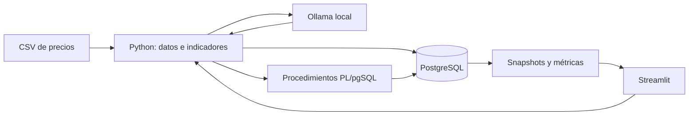

# Simulador de Trading Inteligente

Proyecto educativo que compara cuatro agentes de inversión con estrategias diferentes y un benchmark de comprar y mantener. Los agentes interpretan indicadores del mercado usando Ollama; Python calcula los indicadores y PostgreSQL valida y registra las operaciones. La interfaz local de Streamlit permite revisar datos, controlar una simulación y comparar resultados.

## Objetivo

El proyecto muestra cómo integrar una base de datos transaccional, datos históricos de mercado, un modelo de lenguaje local y una interfaz de análisis. No es una herramienta de asesoría financiera ni predice rendimientos reales.

## Arquitectura y flujo diario



Cada jornada, Python lee precios hasta la fecha procesada, calcula retorno 1/5/20 días, SMA 5/20, RSI 14 y volatilidad 20 días, y prepara el estado del agente. Ollama produce una sola respuesta JSON por agente y jornada. Python valida la respuesta; PostgreSQL consulta el cierre oficial de la fecha, valida saldo, posición y límites, y actualiza las tablas dentro de una transacción. Al cerrar la jornada se guardan snapshots.

## Estructura actual

```text
agents/       Prompts y perfiles de los agentes
data/         CSV reproducible de precios históricos
docs/         Documentación del esquema, motor, métricas e interfaz
reports/      CSV y HTML que genera simulador.metricas
simulador/    Configuración, datos, indicadores, motor, métricas e interfaz
sql/          Esquema, procedimientos y pruebas de PostgreSQL
app.py        Aplicación Streamlit actual
config.yaml   Tickers, periodo, capital y modelo
docker-compose.yml
requirements.txt
.env          Credenciales locales; no se debe subir al repositorio
```

El lanzador actual es `app.py` en la raíz. El prompt inicial planteó `app/main.py`, pero esa reubicación no está hecha todavía. El archivo `.gitignore` actual también ignora `sql/`; si los compañeros deben obtener los scripts al clonar GitHub, quita esa regla o inclúyelos en el backup que compartas.

## Requisitos

- Windows 11 y PowerShell.
- Python 3.11 o superior (el entorno del proyecto se creó con Python 3.13).
- PostgreSQL 15+ local en 5432, o Docker Desktop para PostgreSQL en 5433.
- Ollama instalado y ejecutándose en `http://localhost:11434`.
- Modelo `llama3.2:3b` (o `qwen2.5:3b`) descargado.

## Instalación

Abre PowerShell en la raíz del proyecto:

```powershell
py -3.13 -m venv .venv
.\.venv\Scripts\python.exe -m pip install -r requirements.txt
if (-not (Test-Path .env)) { Copy-Item .env.example .env }
```

Edita `.env` con tu usuario y contraseña. Mantén `.env` fuera de Git. Para PostgreSQL local en el puerto 5432, configura `DB_PORT=5432` y no inicies Compose. Para Docker, deja `DB_PORT=5433` y `POSTGRES_HOST_PORT=5433`, y ejecuta:

```powershell
docker compose up -d
```

Descarga el modelo una vez:

```powershell
ollama pull llama3.2:3b
```

## Crear y preparar la base

Desde la interfaz, configura `.env` con `DB_NAME=simulador-trading-demo`, inicia Streamlit y abre **Configuración y datos**. Si la base no existe, la opción **Crear o reiniciar base demo** intenta crearla y aplicar `sql/01_schema.sql` y `sql/02_procedures.sql`. Requiere permiso `CREATEDB`. Si la base ya existe, la opción borra y recrea el esquema `public`; para confirmar debes marcar la casilla y escribir el nombre exacto. Esta opción solo permite operar en la base demo. Cierra conexiones a esa base en pgAdmin antes del reinicio.

Si prefieres pgAdmin, crea la base y ejecuta los archivos `sql/01_schema.sql`, `sql/02_procedures.sql` y, para validar, `sql/03_tests.sql` desde Query Tool. `03_tests.sql` está diseñado para revertir sus datos de prueba.

Después descarga y carga precios desde **Configuración y datos**, o usa los comandos siguientes.

## Uso desde la interfaz

Inicia la aplicación:

```powershell
.\.venv\Scripts\python.exe -m streamlit run app.py
```

En **Configuración y datos**, elige tickers, fechas, capital, días y modelo; guarda, descarga y carga el CSV. En **Simulación**, usa el dry-run para probar sin Ollama ni cambios persistentes, **Avanzar 1 día** para una demostración controlada, o **Iniciar / Pausar / Reanudar** para procesar varias jornadas. La página **Agentes** presenta decisiones, órdenes y posiciones. **Mercado** muestra precios e indicadores. **Métricas** muestra la clasificación y permite exportar tablas CSV.

Los controles normales solo están habilitados en `simulador-trading-demo`. El avance de un día y la simulación normal escriben resultados en esa base; dry-run revierte sus cambios.

## Uso por línea de comandos

Desde la raíz y con `.venv` activado (o usando la ruta del ejecutable):

```powershell
.\.venv\Scripts\python.exe -m simulador.descargar_datos
.\.venv\Scripts\python.exe -m simulador.cargar_datos
.\.venv\Scripts\python.exe -m simulador.motor --dry-run
.\.venv\Scripts\python.exe -m simulador.motor
.\.venv\Scripts\python.exe -m simulador.metricas
```

La primera pareja descarga el CSV y lo carga. `--dry-run` simula hasta tres fechas con reglas fijas, revierte cambios y no llama a Ollama. Sin esa opción, el motor ejecuta la simulación configurada y sí usa el modelo. Métricas escribe `reports/ranking_agentes.csv`, `reports/evolucion_portafolios.csv` y `reports/graficos_agentes.html`.

## Configuración y lectura de resultados

`config.yaml` contiene tickers, intervalo y ruta del CSV, días hábiles, capital inicial y parámetros de Ollama. `.env` contiene host, puerto, base, usuario y contraseña de PostgreSQL. Los cuatro agentes usan el mismo modelo; cambian los prompts de sistema.

Retorno mide el cambio respecto al capital inicial. Drawdown mide una caída desde un máximo anterior. Sharpe compara retorno medio y variación, con tasa libre de riesgo cero en esta versión. Con solo 30 días hábiles, estas medidas son sensibles a la muestra y no deben tomarse como pronóstico.

## Documentación

Empieza por el [índice de documentos](docs/00_indice.md). La [guía de defensa](docs/08_guia_de_defensa.md) contiene explicaciones resumidas para la presentación.

## Limitaciones y solución de problemas

- **`pg_dump` o `psql` no se reconoce:** instala las herramientas de PostgreSQL o usa Query Tool de pgAdmin. El proyecto no necesita `pg_dump` para iniciar la app.
- **Conexión rechazada:** confirma que PostgreSQL está iniciado y que `DB_PORT` coincide con el servicio (5432 local o 5433 Docker).
- **No se reconoce el modelo:** ejecuta `ollama pull llama3.2:3b` y revisa `ollama.host` en `config.yaml`.
- **Streamlit dice que falta `app.py`:** asegúrate de estar en `C:\Users\leeho\simulador-trading` antes de ejecutar el comando.
- **Dry-run:** no llama a Ollama y revierte la transacción al terminar.
- **Reinicio demo:** requiere conexión administrativa para crear la base; cierra sesiones existentes y confirma el nombre. Reiniciar borra los datos del esquema `public` de la demo.
- **Gráficos PNG:** la app y el reporte actual muestran Plotly interactivo y CSV; la exportación PNG aún está pendiente.
- **Informes `.docx` y `.pptx`:** deben generarse con los resultados de la simulación final; no se incluyen cifras nuevas hasta regenerar y confirmar la corrida definitiva.

Consulta [Docker](docs/09_docker_para_principiantes.md), [interfaz](docs/10_interfaz_streamlit.md) y [resultados](docs/07_resultados_y_analisis.md) para más detalle.

