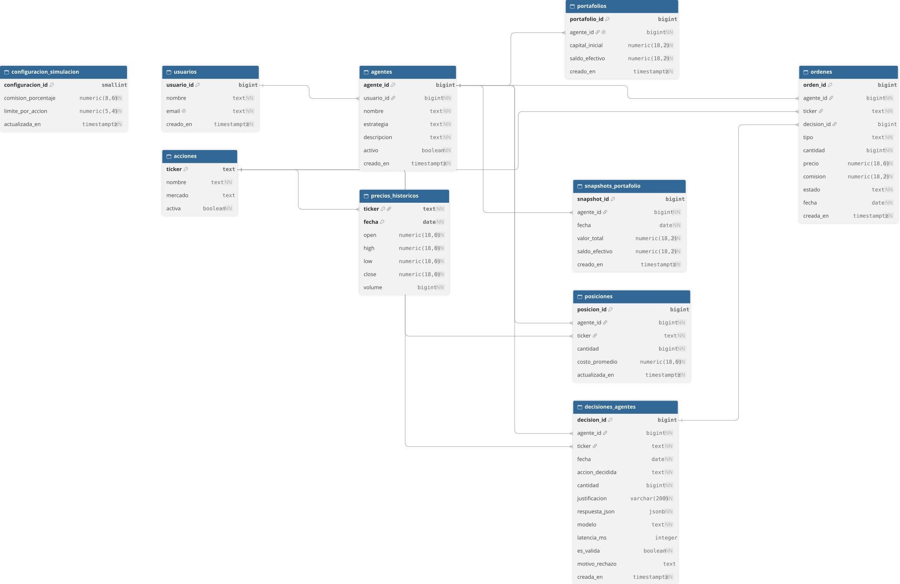

# 1. Modelo de datos

`sql/01_schema.sql`: El esquema separa usuarios, agentes, instrumentos financieros, precios, portafolios y actividad para evitar duplicar datos y facilitar las consultas de la simulacion.

## Diagrama entidad-relación

Tablas
- **usuarios:** dueño lógico de uno o varios agentes. El correo es único.
- **agentes:** estrategia y descripción de cada inversor virtual. La estrategia
  admite los cuatro agentes del proyecto y el benchmark.
- **acciones:** catálogo de tickers que se pueden analizar y negociar.
- **precios_historicos:** precio OHLCV por ticker y fecha. La clave compuesta
  impide guardar dos cotizaciones del mismo día.
- **portafolios:** saldo en efectivo y capital inicial por agente. Hay un
  portafolio por agente.
- **posiciones:** cantidad y costo promedio de cada acción que posee un agente.
  No se almacenan posiciones de cantidad cero.
- **decisiones_agentes:** decisión del modelo, JSON original, validez, modelo,
  latencia y motivo de rechazo.
- **ordenes:** operaciones que sí llegaron a ejecutarse. El precio se toma de la
  tabla de precios, y la comisión queda registrada.
- **snapshots_portafolio:** valor total y efectivo observados al cierre de cada
  fecha.
- **configuracion_simulacion:** comisión y concentración máxima configurables.
  La fila inicial contiene 0,1% y 30%.

Las claves primarias y foráneas aseguran identidad y relaciones válidas. Los
CHECK evitan cantidades negativas, precios no positivos y estrategias o
acciones fuera del conjunto permitido. Los índices aceleran consultas por
agente, fecha y periodo de simulación.

La separación entre precios, posiciones y órdenes evita copiar los precios de
mercado a cada posición. Las órdenes guardan el precio al que se ejecutaron,
mientras que las cotizaciones diarias permanecen como fuente de valoración.